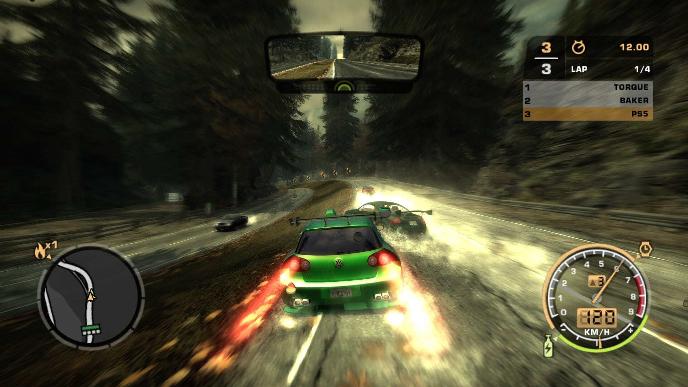
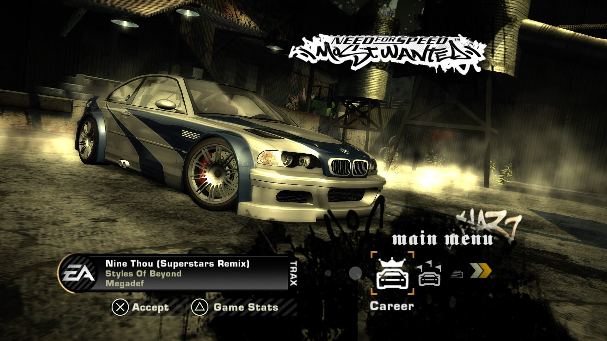
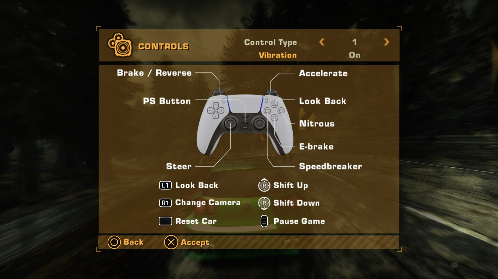
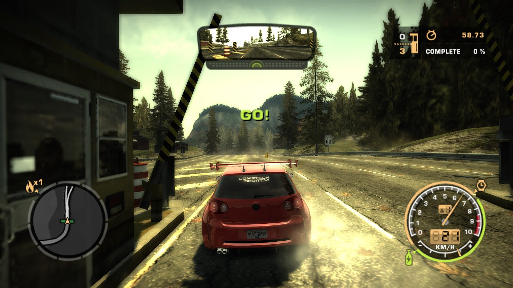
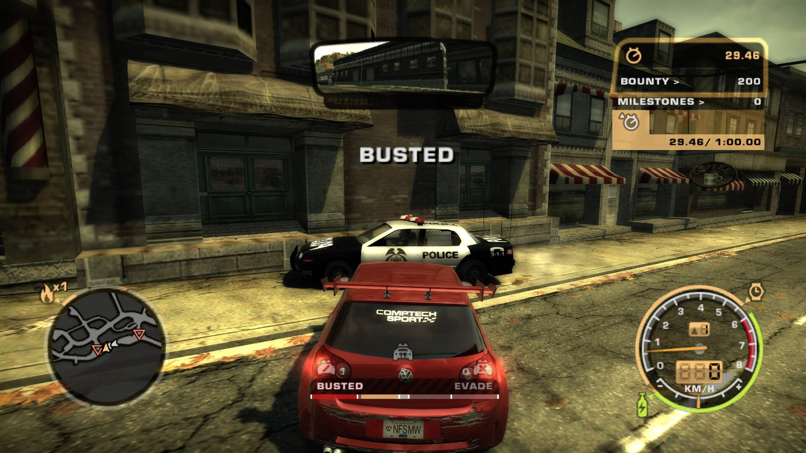
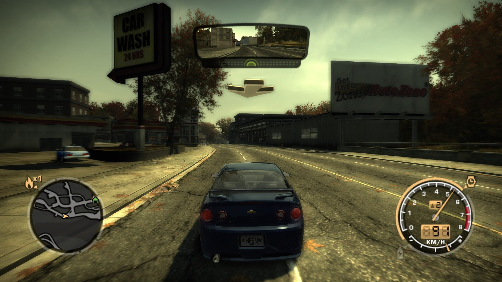
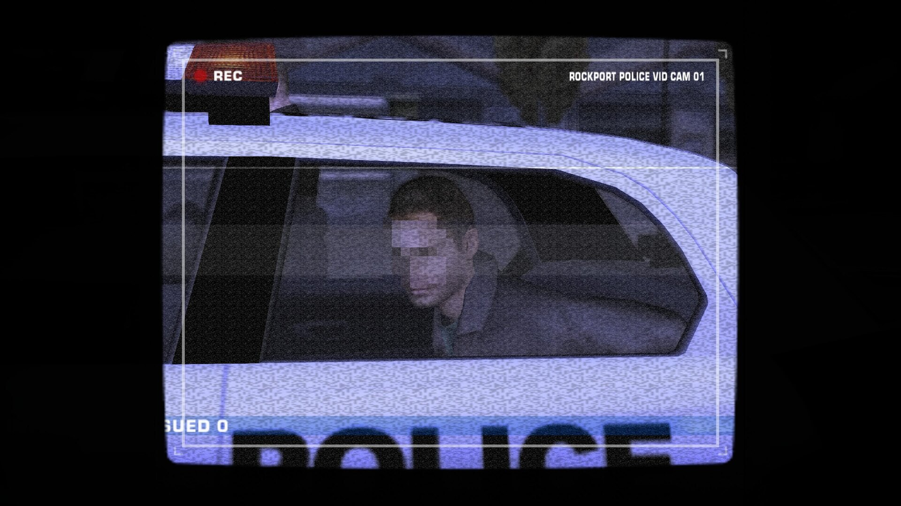
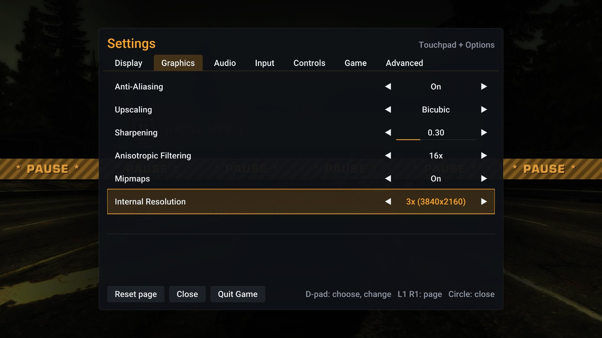
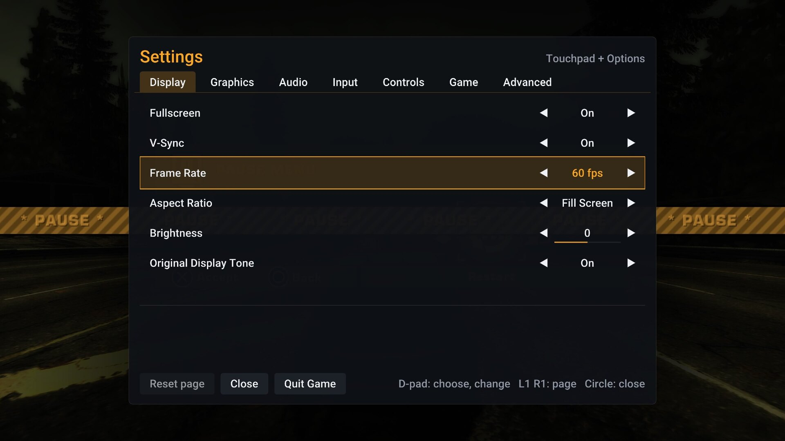

<p align="center">
  <picture>
    <source media="(prefers-color-scheme: dark)" srcset="assets/speedbreaker-banner-dark.png">
    
  </picture>
</p>

<p align="center">
  <b>SpeedBreaker for PS5: <i>Need for Speed: Most Wanted</i> (2005), the Xbox 360 version<br>
  statically recompiled into a native app for homebrew-enabled PS5 consoles.<br>
  Not an emulator, and not the PC version. Bring your own disc.</b>
</p>

<p align="center">
  <a href="https://github.com/bystritskiy/speedbreaker-ps5/releases/latest"><b>Download</b></a>
  &nbsp;·&nbsp;
  <a href="#install">Install</a>
  &nbsp;·&nbsp;
  <a href="#controls">Controls</a>
  &nbsp;·&nbsp;
  <a href="#reporting-a-bug">Report a bug</a>
</p>

<p align="center">
  
  <br>
  <sub>A race on the PS5, rendered at 3840x2160.</sub>
</p>

> [!IMPORTANT]
> **This is SpeedBreaker-ps5, an unofficial fork of
> [SpeedBreaker](https://github.com/SpeedBreakerProject/speedbreaker) by project(u) that adds a
> native PlayStation 5 build.** It is not made by project(u), and neither it nor SpeedBreaker is
> affiliated with, endorsed by or sponsored by Electronic Arts Inc., the Need for Speed brand or
> Sony Interactive Entertainment. For Steam Deck, Linux, Windows, Mac, iPhone and iPad, get
> SpeedBreaker itself; report bugs of the PS5 build here, not upstream.
>
> **No game files are included or distributed.** To play, you need your own legally obtained
> backup of your own Xbox 360 disc of *Need for Speed: Most Wanted* (2005), USA version. Please
> don't ask for, or share, game files or disc images. See the full [legal notice](#legal-notice).

**Contents:** [What it is](#what-it-is) · [Highlights](#highlights) ·
[Requirements](#requirements) · [Install](#install) · [Controls](#controls) ·
[Settings](#settings) · [Your files](#your-files) · [Reporting a bug](#reporting-a-bug) ·
[Known issues](#known-issues) · [For developers](#for-developers) · [Credits](#credits) ·
[License](#license) · [Legal notice](#legal-notice)

## What it is

SpeedBreaker is a static recompilation of the Xbox 360 version of *Need for Speed: Most Wanted*
(2005): the Xbox 360 release's own code, translated into native code ahead of time, with a
runtime that stands in for the console. This fork builds it as a PS5 app: it runs on the PS5's
own CPU and GPU, without an emulator and without a Windows layer.

It plays the files of your own disc from the console's storage. The app holds no game data:
even its PlayStation button text is made at run time from your disc's own text.

## Highlights

- **Native 4K.** The 3D scene renders at 3840x2160 (3x the Xbox 360's 720p), with 16x
  anisotropic filtering.
- **Up to 60 fps,** locked to the TV's 60 Hz; most of a race holds 60.
- **DualSense throughout.** Cross, Circle, Square, Triangle, L1/R1, L2/R2, Options and Touchpad
  prompts in the menus and races, and a DualSense diagram on the controls and loading screens,
  all drawn for this port. Rumble works.
- **PlayStation wording.** The menus say PS Button, Options and the PS5's names instead of the
  Xbox ones, in all ten languages.
- **The original look:** sunlit roads and shadows as on the console, the game's own display tone,
  with Anti-Aliasing, Sharpening and a Brightness setting on top.
- **A settings menu that pauses the game:** Touchpad + Options, mid-race too.
- **One-button bug reports.** Logs, settings and a screenshot go into one zip file on the
  console. Nothing is uploaded.

<table>
  <tr>
    <td width="50%"><br><sub>The main menu, with DualSense prompts.</sub></td>
    <td width="50%"><br><sub>The game's Controls screen, with this port's DualSense diagram.</sub></td>
  </tr>
  <tr>
    <td width="50%"><br><sub>The start of a race.</sub></td>
    <td width="50%"><br><sub>A pursuit that ended badly.</sub></td>
  </tr>
  <tr>
    <td width="50%"><br><sub>Free roam in Career.</sub></td>
    <td width="50%"><br><sub>A Career cutscene.</sub></td>
  </tr>
  <tr>
    <td width="50%"><br><sub>The settings menu: Graphics, at 3840x2160.</sub></td>
    <td width="50%"><br><sub>The settings menu: Display.</sub></td>
  </tr>
</table>

<sub>Screenshots: SpeedBreaker-ps5 on a PS5, captured by the console at 2560x1440 and scaled to
1920x1080; otherwise unedited. The game content in them belongs to its owners.</sub>

## Requirements

- A **PS5 that runs homebrew**, with **ShadowMountPlus** (it puts folder apps on the home screen)
  and an **FTP server** (ftpsrv, port 2121) for copying files. This is homebrew, not a
  PlayStation Store app.
- Your own **USA (NTSC-U) Xbox 360 disc** of *Need for Speed: Most Wanted* (2005), extracted: its
  `default.xex` has SHA-256 `aebdf3c14d1e4e4ed2c130d94bc1a0e97bd6d5bf39bdfdef33c3909c9cc4ba4c`.
  Other regions aren't supported on the PS5 yet.
- About 7.5 GB free on the console for the game files.

## Install

1. **The app.** Download `PPSA90505.zip` from the [latest release](https://github.com/bystritskiy/speedbreaker-ps5/releases/latest),
   unpack it, and copy the `PPSA90505` folder to `/data/homebrew/` on the console. The
   **SpeedBreaker** tile appears on the home screen. A homebrew store that lists SpeedBreaker can
   install it for you instead.
2. **Your game files.** Extract your disc image (for example with extract-xiso) and copy
   `default.xex`, `NFS/` and `Movies/` (49 files, 7.1 GB) to `/data/speedbreaker/game/`. The
   uploader checks every file against the USA disc, reads each one back, and marks the game as
   installed only when all of them match:

   ```sh
   python3 -I port/ps5/tools/upload-game.py --addr <console IP> <extracted disc folder>
   ```

   Or put the disc image (`.iso`) in `/data/speedbreaker/`, `/data/` or the top of a USB drive,
   and the first start offers to install it.
3. **Play.** Start the tile. The first race compiles its shaders; they are kept for next time.

**To update,** copy the new `PPSA90505` folder over the old one. Your saves, settings and game
files in `/data/speedbreaker/` are kept.

## Controls

The game plays with its own Xbox 360 controls, matched **by position** on the DualSense: Cross is
A, Circle is B, Square is X and Triangle is Y. The prompts on screen show the DualSense's buttons.

| Xbox 360 control | DualSense |
|---|---|
| Left stick | Left stick: steer |
| Right / left trigger | R2 / L2: accelerate / brake and reverse |
| A / B / X / Y | Cross / Circle / Square / Triangle |
| LB / RB | L1 / R1: look back / change camera |
| Right stick | Right stick: up and down shift gears |
| D-pad, stick clicks | D-pad, L3 / R3 |
| Start | Options |
| Back | Touchpad click |

**Touchpad + Options** together open or close the settings. Because of that chord, the game sees
the touchpad click a moment late: a tap arrives when you let go.

## Settings

The game pauses while the settings are open. The D-pad chooses and changes a row, L1 and R1 turn
pages, and Circle closes the menu. Every change applies at once and is saved when you close it.

- **Display:** V-Sync, Frame Rate (60 fps / 30 fps / Auto), Aspect Ratio, Brightness and
  Original Display Tone (the gamma ramp a real Xbox 360 sends to a TV). The PS5 is always full
  screen.
- **Graphics:** Anti-Aliasing, Upscaling, Sharpening, Anisotropic Filtering (16x by default) and
  Internal Resolution (3x, 3840x2160, on the PS5).
- **Audio, Input** (deadzones, Vibration), **Game** (Language: one of ten, from the disc's own
  text) and **Advanced** (Asynchronous Shaders, Performance Overlay, **Save Bug Report**).

There is no Check for Updates on the PS5: the app never goes online.
[SpeedBreaker's README](https://github.com/SpeedBreakerProject/speedbreaker#settings) describes
every setting in full.

## Your files

Everything SpeedBreaker writes is in `/data/speedbreaker/`: `settings.toml`, your saves,
`logs/`, the shader cache (`cache/`) and the installed game (`game/`). The app folder in
`/data/homebrew/PPSA90505/` holds only the program, its artwork and its licenses.

## Reporting a bug

1. Open the settings (Touchpad + Options), go to **Advanced**, and choose **Save Bug Report**.
2. The zip goes to `/data/speedbreaker/`, named for the version you were running, for example
   `speedbreaker-bug-report-v0.2.0-<date>_<time>.zip`. Copy it off the console over FTP, or let
   `port/ps5/tools/fetch-report.py --addr <console IP> --output <folder>` fetch the newest one.
3. Open an [issue](https://github.com/bystritskiy/speedbreaker-ps5/issues), attach the zip, and say
   what you were doing, what you expected and what happened.

The zip holds recent logs, any crash and hang reports, your settings, a summary of the system and
a screenshot of the last game frame. If the game crashed, start it again and save a report: the
crash report is included. **Never attach game files or disc images to an issue.**

## Known issues

- **USA disc only** for now.
- **Not every part of the game has been played on a console yet:** menus, Career, Quick Race,
  pursuits, saves, sound, controls and rumble have; [`docs/PS5.md`](docs/PS5.md) is the log of
  what was run and seen.
- **Most of a race holds 60 fps, not all of it:** busy moments can dip into the 50s.
- **The first time a place is seen,** objects can pop in for a frame or two while their shaders
  compile (Asynchronous Shaders); the next time, they come from the cache.

## For developers

### How it works

[XenonRecomp](https://github.com/hedge-dev/XenonRecomp) translates the game's PowerPC code into
C++ ahead of time, and that C++ is compiled for the PS5's x86-64 CPU. SpeedBreaker's runtime
stands in for the Xbox 360: its kernel and system software, its GPU (a Vulkan renderer that
translates the Xenos GPU's commands and shaders), its XMA audio and its controllers.

On the PS5 ([`port/ps5`](port/ps5/README.md)), the runtime runs on the open-source RADV Vulkan
driver linked into the app, with a VideoOut display and AudioOut sound under SDL3, and the
DualSense as a virtual gamepad. It is built with LLVM 18 and the public payload SDK from
community projects (PS5_Vulkan, PS5_PayloadSDK, PS5_Mesa); no Sony SDK is used.

### Building from source

The repository contains no game code: the build recompiles your own `default.xex`, from the USA
disc. The generated code (`ppc/`), the game files (`game/`) and the toolchain (`tools/`) are
ignored by git. **Never commit or share them.**

On a Mac, from the repository root:

```sh
scripts/setup_tools.sh    # XenonRecomp + SpeedBreaker's patches, extract-xiso, FFmpeg's source

# Extract your own disc image into game/files and check the executable.
mkdir -p game/files
tools/extract-xiso/build/extract-xiso -d game/files -x /path/to/your-backup.iso
shasum -a 256 game/files/default.xex
# must print aebdf3c14d1e4e4ed2c130d94bc1a0e97bd6d5bf39bdfdef33c3909c9cc4ba4c

# Translate the game's code into C++ (writes ppc/).
mkdir -p ppc
tools/XenonRecomp/build/XenonRecomp/XenonRecomp config/nfsmw.toml tools/XenonRecomp/XenonUtils/ppc_context.h
```

Then build, link and copy the app as [`port/ps5/README.md`](port/ps5/README.md) describes: the
console toolchain (`setup-ps5-vulkan.sh`, with Docker), the PS5 libraries, the build, `link.sh`,
`deploy-app.py`, and `package-release.sh` for a release.

## Credits

SpeedBreaker is made by **project(u)**; this PS5 port is by **bystritskiy**. It stands on the
shoulders of a lot of open-source work: the **hedge-dev** team's XenonRecomp and the approach
Unleashed Recompiled pioneered, the **Xenia** project's decade of Xbox 360 research, and for the
PS5, **Mihawk-99** and **BlackBearReloaded**'s PS5_Vulkan, PS5_PayloadSDK and PS5_Mesa, the
ps5-payload-dev SDK, and the Mesa and LLVM projects.

| Project | What it does here | License |
|---|---|---|
| [SpeedBreaker](https://github.com/SpeedBreakerProject/speedbreaker) (project(u) and contributors) | The recompilation, the runtime, the renderer and the menus | GPL-3.0-or-later |
| [XenonRecomp](https://github.com/hedge-dev/XenonRecomp) (hedge-dev and contributors) | The PowerPC-to-C++ recompiler; its XenonUtils (XEX loading) is built into the runtime | MIT |
| [Unleashed Recompiled](https://github.com/hedge-dev/UnleashedRecomp) (hedge-dev and contributors) | The reference runtime; parts of the kernel, XAM, memory and threading code are adapted from it | GPL-3.0-or-later |
| [Xenia](https://github.com/xenia-project/xenia) (Ben Vanik and Xenia contributors) | GPU register, microcode and Xenos headers, and the reference for its kernel, XMA and GPU behaviour | BSD-3-Clause |
| [PS5_Vulkan](https://github.com/mihawk-99/PS5_Vulkan) (BlackBearReloaded, Mihawk-99) | The app's start-up code, its clean-room `libc.prx`, and the tools that link and sign it | GPL-3.0-or-later |
| [PS5_PayloadSDK](https://github.com/mihawk-99/PS5_PayloadSDK) (ps5-payload-dev, Mihawk-99) | The C library, module stubs and PS5 platform layer | GPL-3.0-or-later |
| [Mesa](https://www.mesa3d.org/) with [PS5_Mesa](https://github.com/mihawk-99/PS5_Mesa)'s PS5 winsys | RADV, the Vulkan driver | MIT |
| [LLVM](https://llvm.org/) 18 | The compiler, libc++ and compiler-rt's builtins | Apache-2.0 WITH LLVM-exception |
| [FFmpeg](https://ffmpeg.org/) 7.1.1 | XMA decoding: a decoder-only static build with a SpeedBreaker patch | LGPL-2.1-or-later |
| [SDL3](https://www.libsdl.org/) | Display, input, audio and the app's lifecycle | zlib |
| [Dear ImGui](https://github.com/ocornut/imgui) (Omar Cornut) | The installer and settings UI | MIT |
| [Roboto](https://fonts.google.com/specimen/Roboto) (Google) | The UI font | Apache-2.0 |
| [glslang](https://github.com/KhronosGroup/glslang) (Khronos) | Shader compilation at runtime | BSD-3-Clause and others |
| [o1heap](https://github.com/pavel-kirienko/o1heap), [toml++](https://github.com/marzer/tomlplusplus), [SIMDe](https://github.com/simd-everywhere/simde), [libmspack](https://github.com/kyz/libmspack), [tiny-AES-c](https://github.com/kokke/tiny-AES-c), [TinySHA1](https://github.com/mohaps/TinySHA1), [FidelityFX FSR 1](https://github.com/GPUOpen-Effects/FidelityFX-FSR) | The guest heap, `settings.toml`, SIMD, LZX, XEX decryption, SHA-1, FSR 1 upscaling | MIT; LGPL-2.1 (libmspack); Unlicense (tiny-AES-c); ISC-style (TinySHA1) |

Full license texts are in [THIRD_PARTY_NOTICES.md](THIRD_PARTY_NOTICES.md) and
[LICENSES/](LICENSES/), and the app carries them in its `licenses/` folder. The source code of the
LGPL and GPL parts in the app is published next to each release, as
`SpeedBreaker-<version>-ps5-third-party-source.tar.xz`.

## License

SpeedBreaker is free software: you can redistribute it and/or modify it under the terms of the
**GNU General Public License** as published by the Free Software Foundation, either version 3 of
the License, or (at your option) any later version (GPL-3.0-or-later). See [COPYING](COPYING)
and [NOTICE](NOTICE). Third-party components keep their own licenses, listed above.

Copyright (C) 2026 project(u) and SpeedBreaker contributors.

## Legal notice

SpeedBreaker is an unofficial, fan-made project by project(u). This PS5 fork is not made by
project(u). Neither is **affiliated with, endorsed by or sponsored by Electronic Arts Inc., the
Need for Speed brand or Sony Interactive Entertainment.**

"Need for Speed" and "Most Wanted" are trademarks of Electronic Arts Inc. PlayStation, PS5,
DualSense and the PlayStation Shapes (Cross, Circle, Square and Triangle) are trademarks of Sony
Interactive Entertainment Inc.; the controller artwork and button symbols in this port are its
own drawings, not Sony's artwork. It uses no Sony SDK: only public, community-made tools. All
other trademarks, including Xbox and Xbox 360, belong to their respective owners. They are used
here only to describe what SpeedBreaker works with. The game is named only to say which game
SpeedBreaker runs; no logos, box art or key art of the game are used. The game content visible
in screenshots belongs to its owners.

**No game files are included or distributed.** SpeedBreaker contains no game data or assets: no
textures, models, audio, movies, game text or disc files. To play, you need your own legally
obtained backup of your own Xbox 360 disc of *Need for Speed: Most Wanted* (2005).

SpeedBreaker is provided "as is", without warranty of any kind, as set out in the GNU General
Public License.
